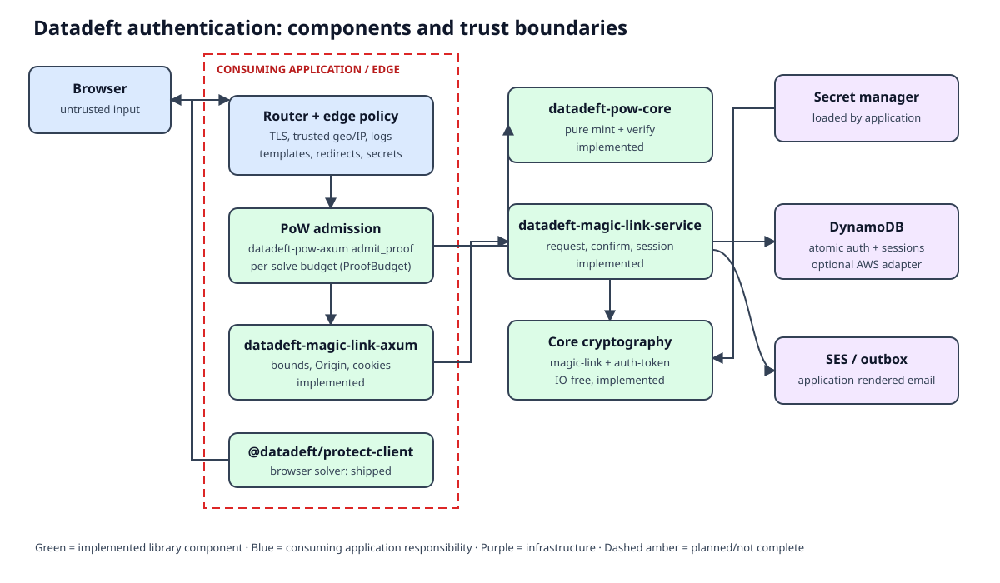
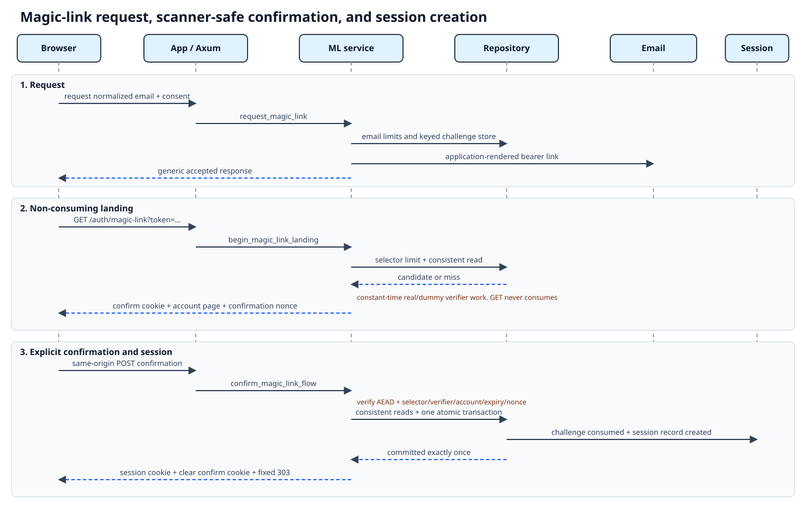
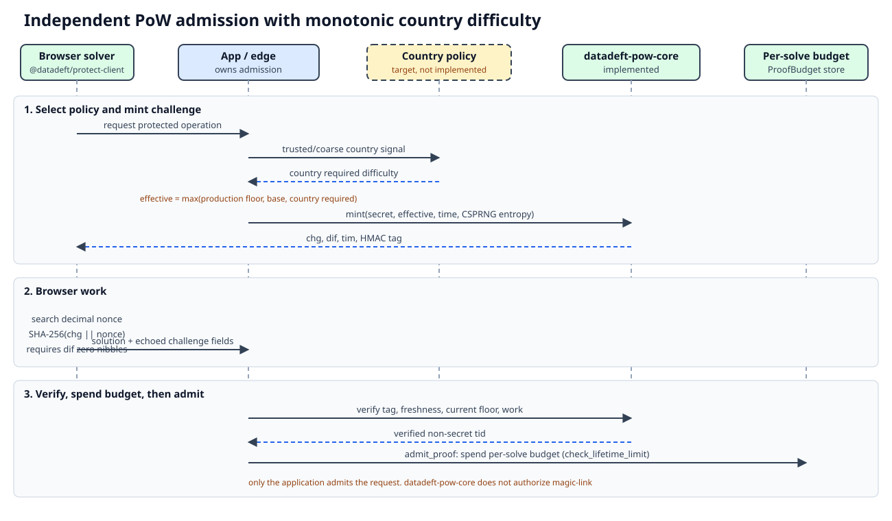

# Architecture

This document describes the current repository.

The repository provides reusable authentication libraries. The consuming
application owns routes, deployment policy, secrets, email templates, logs, and
edge policy. It wires proof-of-work admission with `datadeft-pow-axum`.



## Components

| Component | Responsibility | Status |
| --- | --- | --- |
| `datadeft-pow-core` | Mint and verify PoW challenges. | Ready |
| `datadeft-pow-axum` | Axum PoW create/validate, proof cookie, `admit_proof`. | Ready |
| `datadeft-auth-token-core` | Encrypt cookies and manage purpose keys. | Ready |
| `datadeft-magic-link-core` | Parse tokens and compute HMAC lookup values. | Ready |
| `datadeft-magic-link-service` | Run request, confirmation, session, and repository logic. | Ready |
| `datadeft-magic-link-axum` | Parse HTTP input and create safe responses. | Ready |
| `datadeft-magic-link-aws` | Store data in DynamoDB and send email with SES. | Ready for test deployment |
| Consuming application | Configure routes, secrets, templates, logs, and edge policy. | Required |
| `@datadeft/protect-client` | Solve PoW in the browser. | Ready |
| Example app (`examples/axum-magic-link`) | Show a full fake-backed Axum flow. | Available |

Dependencies point one way only:

```text
datadeft-auth-token-core     -> no workspace crates
datadeft-magic-link-core     -> datadeft-auth-token-core
datadeft-magic-link-service  -> datadeft-magic-link-core, datadeft-auth-token-core
datadeft-magic-link-axum     -> datadeft-magic-link-service
datadeft-magic-link-aws      -> datadeft-magic-link-service
datadeft-pow-core            -> datadeft-auth-token-core
datadeft-pow-axum            -> datadeft-pow-core, datadeft-auth-token-core

consuming application        -> selected adapters and services
```

## Magic-link flow



Request (`POST`):

1. The request service validates consent, then normalizes
   (`NormalizedEmail::normalize`) and validates the email.
2. It applies keyed-email limits.
3. It creates an independent selector and verifier.
4. The repository addresses records by keyed lookup material and never stores
   the raw token.
5. The outbox sends the bearer link.

Landing (`GET`):

6. The landing route parses the token.
7. It applies a keyed-selector limit.
8. It reads repository state.
9. It compares verifier material in constant time.
10. It does dummy work on a miss.
11. It mints a five-minute confirm cookie. The cookie binds the selector,
    verifier proof, account, expiry, and nonce.
12. It never consumes the challenge.
13. The page shows the account and asks for a same-origin `POST`. The account
    is masked by default (`AccountDisplay`).

Confirm (`POST`):

14. The `POST` route validates the flow state.
15. The repository consumes the challenge and creates the session in one
    atomic commit.
16. The browser gets a session cookie and a fixed `303` redirect.

Session:

17. Session validation checks the cookie and server state.
18. Logout revokes server state before it clears the cookie.

## PoW flow



`datadeft-pow-core` is deterministic. It does not read clocks, files, network,
or environment variables. It:

1. Mints a challenge from a server secret, difficulty, time, and entropy.
2. Authenticates challenge metadata with HMAC-SHA-256.
3. Verifies freshness, minimum difficulty, and SHA-256 work.
4. Returns a stable replay identifier.

The consuming application owns country-aware PoW policy. The
`effective_difficulty` rule is in [PoW decisions](onboarding.md#pow-decisions).
The repository does not yet include a country-to-difficulty policy.

The per-solve budget (`admit_proof`) bounds reuse of a proof. The example wires
PoW end to end, with `protectedFetch` in the browser.

PoW stays independent from magic-link. Magic-link does not carry a PoW result,
IP address, or client key.

## Trust boundaries

| Boundary | Untrusted input | Required control |
| --- | --- | --- |
| Browser to app | Email, token, cookies, body, headers, PoW solution | Bounds, parse rules, generic errors, TLS |
| Edge to origin | Request target, IP, country headers | Trusted overwrite rules and token-safe logs |
| App to libraries | Clock, CSPRNG, keyrings, redirects, templates, policy | Purpose separation and validated config |
| Service to storage | Repository and delivery results | Typed errors and atomic repository contract |
| AWS provider | DynamoDB and SES behavior | IAM, encryption, TTL, tests, and strong reads |
| Email channel | Bearer magic-link token | Short TTL and scanner-safe confirmation |

## Security mechanisms

| Purpose | Mechanism |
| --- | --- |
| Session and confirm cookies | XChaCha20-Poly1305 |
| Key derivation | HKDF-SHA-256 with purpose and key ID |
| Magic-link lookup | HMAC-SHA-256 |
| Magic-link entropy | 128-bit selector and 256-bit verifier |
| Flow state | AEAD body plus confirmation nonce |
| PoW challenge identity | BLAKE3 over time and entropy |
| PoW challenge tag | HMAC-SHA-256 |
| PoW work | SHA-256 with leading zero hex characters |
| PoW replay identity | BLAKE3 challenge digest |
| Constant-time checks | `subtle::ConstantTimeEq` |
| One-time auth | DynamoDB transaction or matching repository action |
| Session revocation | Strong session reads |
| Sensitive memory | Redacted `Debug` and `zeroize` |
| Wire encoding | Lowercase hex and Base62 |

## Complexity

The libraries bound every input before expensive work starts. `n` is the
bounded input length. `d` is the number of required zero hex characters.

| Operation | Time | Memory | Note |
| --- | ---: | ---: | --- |
| PoW mint | `O(n)` | `O(n)` | Fixed entropy and bounded time text. |
| PoW verify | `O(n)` | `O(n)` | One HMAC, time parse, and SHA-256 check. |
| Browser PoW solve | `O(16^d)` expected | `O(1)` | Benchmark before production. |
| Magic-link generation | `O(1)` | `O(1)` | Fixed entropy. |
| Magic-link parse | `O(n)` | `O(n)` | Bounded token grammar. |
| Flow or session AEAD | `O(n)` | `O(n)` | Bounded body size. |
| Base62 encode or decode | `O(n²)` | `O(n)` | Bounded token size. |
| Request path | `O(1)` | `O(1)` | Remote calls dominate. |
| Landing path | `O(1)` | `O(1)` | One strong candidate read. |
| Confirmation path | `O(1)` | `O(1)` | Fixed transaction dominates. |
| Session validation | `O(n)` | `O(n)` | One strong session read. |

## Related documents

- [Integration guide](integration.md)
- [Onboarding](onboarding.md)
- [Security rules](security.md)
- [Formal assurance](formal-methods.md)
- [Operating model](operating.md)
